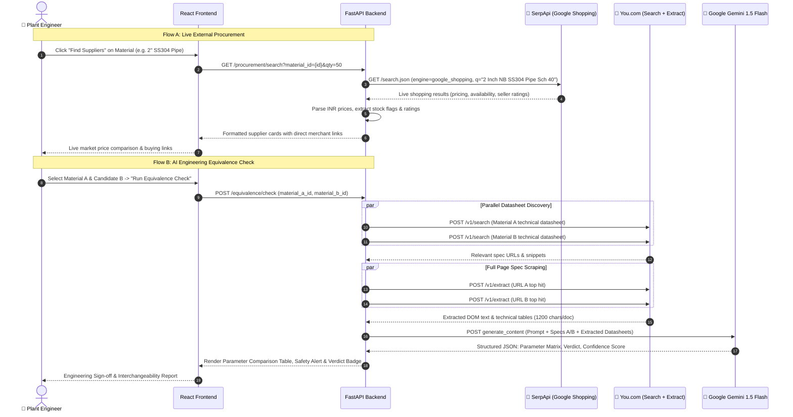

<div align="center">


# Saarthi — Unified Material Master & Intelligence Platform

### *One Nation. One Material Code.*

An enterprise AI platform that unifies, deduplicates, and standardizes material master data across public-sector enterprises (CPSEs) and industrial manufacturing operations, paired with live external procurement intelligence and engineering equivalence verification.

[](#)
[](#)
[](#)
[](#)
[](#)
[](#)
[](#)
[](#)
[](#)
[](#)

</div>

---

## Table of Contents

- [The Problem: Fragmented Material Masters](#the-problem-fragmented-material-masters)
- [The Solution: The CNMC Standard](#the-solution-the-cnmc-standard)
- [System Architecture](#system-architecture)
- [Core Functional Engines](#core-functional-engines)
  - [1. Multimodal Intake & OCR Engine](#1-multimodal-intake--ocr-engine)
  - [2. Semantic Deduplication & Matching (pgvector)](#2-semantic-deduplication--matching-pgvector)
  - [3. Procurement Intelligence Engine (SerpApi)](#3-procurement-intelligence-engine-serpapi)
  - [4. Engineering Equivalence & Interchangeability Engine (You.com + Gemini)](#4-engineering-equivalence--interchangeability-engine-youcom--gemini)
  - [5. Natural Language Query Engine (Text-to-SQL)](#5-natural-language-query-engine-text-to-sql)
  - [6. Interactive Warehouse Inventory Map](#6-interactive-warehouse-inventory-map)
- [Deep Dive: External AI & Market Intelligence](#deep-dive-external-ai--market-intelligence)
  - [SerpApi: Live Google Shopping Price & Vendor Intelligence](#serpapi-live-google-shopping-price--vendor-intelligence)
  - [You.com Search & Extract: Authoritative Technical Datasheet Discovery](#youcom-search--extract-authoritative-technical-datasheet-discovery)
- [Role-Based Experience](#role-based-experience)
- [REST API Reference](#rest-api-reference)
- [Database Schema & Migrations](#database-schema--migrations)
- [Repository Structure](#repository-structure)
- [Local Development Setup](#local-development-setup)
- [Environment Variables](#environment-variables)
- [Testing & Quality Assurance](#testing--quality-assurance)
- [Sample Demo Data & Walkthrough](#sample-demo-data--walkthrough)

---

## The Problem: Fragmented Material Masters

Large industrial enterprises, central public sector enterprises (CPSEs), and manufacturing conglomerates routinely purchase identical items under completely different codes and descriptions:

```
Plant A (Refinery):     "Hex Bolt M8x25 SS304 Full Thd"        -> Item Code: 4001923
Plant B (Pipeline):     "S.S. Hexagonal Bolt 8mm Dia 25mm"     -> Item Code: BLT-M8-304
Plant C (Fertilizer):   "ISO 4014 M8x25 Gr 304 Fastener"       -> Item Code: 88120409
```

This fragmentation causes severe organizational inefficiencies:
1. **Redundant Procurement:** Purchasing high-lead-time spares from vendors when identical stock is already lying idle in nearby warehouses.
2. **Inflated Working Capital:** Millions tied up in safety stock due to lack of cross-plant inventory visibility.
3. **Fragmented Purchasing Power:** Inability to aggregate purchase volumes across facilities to negotiate bulk enterprise discounts.
4. **Catastrophic Downtime:** Delaying unscheduled plant turnarounds because an engineer cannot verify if an on-shelf alternative is safe to use.

---

## The Solution: The CNMC Standard

**Saarthi** enforces the **Common National Material Code (CNMC)**. Every physical material has **one canonical code** structured deterministically based on its engineering specifications:

$$\text{CNMC} = \mathbf{CAT} - \mathbf{SUBCAT} - \mathbf{TYPE} - \mathbf{SPEC} - \mathbf{QUALITY}$$

| Component | Description | Example |
|---|---|---|
| **CAT** | Major Material Category | `MECH` (Mechanical), `ELEC` (Electrical), `CHEM` (Chemicals), `CONS` (Consumables) |
| **SUBCAT** | Functional Subcategory | `FSTNR` (Fasteners), `VALVE` (Valves), `PIPE` (Piping & Fittings), `CABLE` (Cables) |
| **TYPE** | Equipment / Product Type | `BOLT` (Bolts), `BALL` (Ball Valve), `ELBO` (Elbows), `XLPE` (XLPE Cables) |
| **SPEC** | Key Engineering Parameters | `M8X25-SS304` (Thread, Length, Metallurgy) or `2IN-SCH40` (Bore, Schedule) |
| **QUALITY** | QA / Inspection Grade | `A` (Full Mill Test Certificate), `B` (Standard Commercial Grade) |

**Result:** `MECH-FSTNR-BOLT-M8X25-SS304-A` uniquely and unambiguously identifies this exact material across all plants, departments, and ERP instances.

---

## System Architecture

Saarthi decouples operational business logic from data storage, ensuring that high-concurrency client requests are governed through strict role-based access control (RBAC) and database-level transactional guarantees.

```mermaid
flowchart TB
    subgraph Clients["Presentation Layer (React 18 + Vite + Tailwind CSS)"]
        Landing["Public Showcase & ERP Simulator<br/>(SAP / S4HANA / Oracle EBS Demo)"]
        EntryDash["🧾 Entry Operator Dashboard<br/>(OCR Ingestion · Barcode Intake · Confirmations)"]
        EngDash["🔧 Engineer Dashboard<br/>(NL Query · Inventory Map · Procurement · Equivalence)"]
        AccDash["💰 Accounts Dashboard<br/>(Stock Valuation · Price Intelligence · Vendor Analysis)"]
        AdminDash["🛡️ Admin Dashboard<br/>(Catalog Governance · Duplicate Queue · System Health)"]
    end

    subgraph Backend["Application Server (FastAPI · Python 3.11)"]
        Gateway["API Gateway & Middleware<br/>JWT Authentication · Role Guards · CORS"]

        subgraph CoreServices["Data & Inventory Engines"]
            OCRService["OCR & Vision Service"]
            MatchingService["Deduplication Engine (pgvector)"]
            CNMCService["Deterministic CNMC Generator"]
            NLQueryService["Text-to-SQL Query Translator"]
            ReceiptService["Atomic Goods Receipt Transaction Engine"]
        end

        subgraph MarketIntelligence["External Intelligence Domain Engines"]
            ProcureService["Procurement Intelligence Service<br/>(Query Synthesis · Currency & Stock Parsing)"]
            EquivService["Engineering Equivalence Engine<br/>(Parameter Matrix Orchestrator)"]
        end
    end

    subgraph Persistence["Storage & Database Layer (Supabase)"]
        Postgres[("PostgreSQL 15 (ACID Engine)")]
        VectorExt["pgvector Extension (768-dim Index)"]
        AuthSvc["Supabase Auth (RBAC)"]
        Storage["Object Storage (Bill Images / Docs)"]
    end

    subgraph SerpApiCloud["🛒 SerpApi Cloud Platform"]
        GoogleShopping["Google Shopping Engine<br/>(gl=in · hl=en · Real-Time Pricing in INR)"]
    end

    subgraph YouComCloud["📑 You.com Cloud Platform"]
        YouSearch["You.com Search API (/v1/search)<br/>(Datasheets, Mill Test Reports & Standards)"]
        YouExtract["You.com Extract API (/v1/extract)<br/>(Full DOM Text & Spec Table Extraction)"]
    end

    subgraph GeminiCloud["🧠 Google Gemini AI Cloud"]
        GeminiVision["Gemini 1.5 Flash (Vision OCR)"]
        GeminiEmbed["Gemini Embeddings (768-dim text-embedding-001)"]
        GeminiReasoning["Gemini 1.5 Flash (Parameter Analysis & Verdict)"]
    end

    %% Client to Backend
    Clients --> Gateway
    Gateway --> CoreServices
    Gateway --> MarketIntelligence

    %% Core Services to Database
    CoreServices --> Postgres
    CoreServices --> VectorExt
    CoreServices --> Storage
    Clients -.-> AuthSvc

    %% Core AI connections
    OCRService -- "Bill & invoice images" --> GeminiVision
    MatchingService -- "Text embeddings & matching" --> GeminiEmbed

    %% SerpApi Procurement Flow
    EngDash -.->|"1. Sourcing Request (/procurement/search)"| ProcureService
    ProcureService -->|"2. Query Google Shopping"| GoogleShopping
    GoogleShopping -->|"3. Live INR prices, ratings & stock"| ProcureService
    ProcureService -.->|"4. Normalized supplier cards"| EngDash

    %% You.com + Gemini Equivalence Flow
    EngDash -.->|"1. Interchangeability Check (/equivalence/check)"| EquivService
    EquivService -->|"2. Query authoritative datasheets"| YouSearch
    YouSearch -->|"3. Ranked technical URLs"| YouExtract
    YouExtract -->|"4. Scraped technical spec text (1200 chars)"| EquivService
    EquivService -->|"5. Material specs + You.com extracted datasheets"| GeminiReasoning
    GeminiReasoning -->|"6. Multi-attribute comparison matrix & verdict"| EquivService
    EquivService -.->|"7. Engineering advisory report"| EngDash
```



---

## Core Functional Engines

### 1. Multimodal Intake & OCR Engine
When goods arrive at the gate, operators scan either a paper bill or a physical barcode:
- **Gemini 1.5 Flash Vision OCR:** Extracts vendor name, PO number, invoice date, and every line item with description, quantity, unit price, and unit of measure.
- **Barcode & Label Scanner:** Utilizes `@zxing/browser` directly in the browser for client-side camera barcode and QR code decoding without server latency.
- **Atomic Confirmation:** On confirmation, line items are committed in a **single database transaction** (creating missing materials, updating inventory bin records, inserting price history points, and writing immutable audit logs).

### 2. Semantic Deduplication & Matching (`pgvector`)
Every line item is converted to a vector embedding using `models/gemini-embedding-001` (768 dimensions):
- Calculates cosine distance against all approved materials in PostgreSQL:

$$\text{similarity} = 1 - (\vec{E}_{\text{item}} \cdot \vec{E}_{\text{catalog}})$$

- **Exact / High Match ($\ge 0.85$):** Automatically resolves and maps to the existing canonical CNMC.
- **Ambiguous Match ($0.70 \le s < 0.85$):** Enters the **Duplicate Detection Queue** for admin/operator review.
- **No Match ($< 0.70$):** Gemini proposes a new standardized CNMC and attribute set for operator confirmation.

### 3. Procurement Intelligence Engine (SerpApi)
Directly integrated into the plant engineer's workflow and low-stock alert views:
- **Live Market Discovery:** When internal stock drops below reorder thresholds or lead times are excessive, Saarthi queries **Google Shopping via SerpApi** in real time (`gl=in`, `hl=en`) using synthesized technical search strings.
- **Automated Currency & Price Parsing:** Strips Indian Rupee (₹) formatting, thousand-separators, and currency symbols into strict numeric floats, enabling automated total cost estimation for requested batch quantities.
- **Supplier Due Diligence:** Aggregates verified vendor names, customer ratings, review counts, in-stock indicators, and direct external listing links so procurement teams can bypass lengthy RFI cycles.

### 4. Engineering Equivalence & Interchangeability Engine (You.com + Gemini)
Empowers plant engineers to substitute critical components during emergency outages with mathematical confidence:
- **Two-Stage Datasheet Retrieval (You.com API):**
  1. *Search:* Queries `https://api.you.com/v1/search` for manufacturer datasheets, mill test reports, and ASME/ISO/ASTM specification standards.
  2. *Extract:* Calls `https://api.you.com/v1/extract` on top candidate URLs to extract full-text engineering tables and parameter definitions (up to 1,200 characters per document).
- **Multi-Parameter Comparative Matrix:** Google Gemini 1.5 analyzes both materials side-by-side across critical attributes (tensile strength, yield strength, pressure class, temperature range, metallurgy, sealing standard).
- **Strict 3-State Verdict System:**
  - `equivalent`: ALL safety-critical parameters are confirmed matches.
  - `not_equivalent`: ANY safety-critical parameter is a confirmed mismatch.
  - `engineering_review_required`: Safety-critical parameters are unverified or external evidence is insufficient.
  - *All outputs are strictly advisory and require human engineering sign-off before adoption.*

### 5. Natural Language Query Engine (Text-to-SQL)
Allows warehouse personnel and engineers to ask plain English questions:
- *“Where are M8 bolts stored and how many are in stock?”*
- *“Show all mechanical valves below reorder level in WHSE-A”*
- Automatically converts English questions to read-only PostgreSQL queries against secure database views (`v_inventory_full`, `v_low_stock_alerts`). Includes an interactive SQL inspection drawer and execution audit logging.

### 6. Interactive Warehouse Inventory Map
- Visual bin-level inventory locator across facilities (`WHSE-A: Mechanical`, `WHSE-B: Electrical`, `WHSE-C: Chemicals & Consumables`).
- Color-coded bin status (Overstocked, Healthy, Low Stock, Empty) with quick stock adjustment and reorder actions.

---

## Deep Dive: External AI & Market Intelligence

Saarthi deliberately combines specialized external intelligence APIs to provide capabilities that cannot be achieved with private internal ERP databases alone.



### SerpApi: Live Google Shopping Price & Vendor Intelligence

| Parameter | Configuration & Implementation |
|---|---|
| **API Endpoint** | `https://serpapi.com/search.json` |
| **Search Engine** | `engine=google_shopping` |
| **Geographic Targeting** | `gl=in` (India), `hl=en` (English language) |
| **Query Synthesis** | `_build_query(material)` joins `standard_description` + `spec` + `unit_of_measure` |
| **Data Normalization** | Strips non-numeric currency tokens, parses thousand separators, converts into float INR values |
| **Extracted Metadata** | Merchant brand/source, product title, unit price, stock status, star rating (0.0–5.0), review counts, direct listing URL |
| **Resilient Fallback** | If `SERPAPI_KEY` is omitted or quota is exceeded (HTTP 429), API returns `serpapi_configured: false` with graceful UI notification banners rather than crashing |

```python
# Query payload example generated by Saarthi's SerpApi engine
params = {
    "engine": "google_shopping",
    "q": "Seamless Stainless Steel Pipe 2 Inch NB Schedule 40 ASTM A312 Grade TP304 MTR",
    "api_key": settings.SERPAPI_KEY,
    "gl": "in",
    "hl": "en",
    "num": "10",
}
```

### You.com Search & Extract: Authoritative Technical Datasheet Discovery

Industrial equivalence cannot rely on LLM training memory alone — metallurgy standards, pressure-temperature ratings, and chemical compositions require **verifiable source documents**. Saarthi uses You.com's dual-endpoint architecture:

1. **You.com Search API (`/v1/search`):**
   - Discovers authoritative manufacturer datasheets, mill certificates, and standards PDFs.
   - Enriched query format: `"{standard_description} {spec} technical specifications datasheet"`.
   - Returns ranked URLs, titles, and semantic text snippets.

2. **You.com Extract API (`/v1/extract`):**
   - Takes the top-ranked URLs from the search step and performs server-side DOM text extraction.
   - Bypasses paywalls, cleans navigational boilerplates, and returns clean markdown/text up to 1,200 characters per document.
   - Extracts hard specification tables that Gemini ingests directly into its context window.

```json
// Example parameter matrix generated via You.com extracted text + Gemini
{
  "parameters": [
    {
      "name": "Nominal Bore",
      "value_a": "2 Inch (60.3mm OD)",
      "value_b": "2 Inch (60.3mm OD)",
      "match": "match",
      "safety_critical": true
    },
    {
      "name": "Wall Thickness / Schedule",
      "value_a": "3.91 mm (SCH 40)",
      "value_b": "5.54 mm (SCH 80)",
      "match": "mismatch",
      "safety_critical": true,
      "notes": "SCH 80 has heavier wall thickness; pressure rating increases from 172 bar to 241 bar"
    },
    {
      "name": "Material Grade",
      "value_a": "ASTM A312 TP304",
      "value_b": "ASTM A312 TP316",
      "match": "match",
      "safety_critical": true,
      "notes": "TP316 contains 2% Mo, offering superior chloride pitting resistance over TP304"
    }
  ],
  "verdict": "engineering_review_required",
  "verdict_reason": "Material B offers higher pressure rating and corrosion resistance but thicker wall reduces internal flow area.",
  "confidence": 0.94
}
```

---

## Role-Based Experience

| Role | Primary Dashboard | Key Capabilities |
|---|---|---|
| **🧾 Entry Operator** | `/entry` | Bill image upload, webcam barcode scan, line item editor, match verification, goods receipt history. |
| **🔧 Plant Engineer** | `/engineer` | Natural language search (`nl-query`), live bin map (`inventory-map`), external supplier sourcing (`procurement`), equivalence checker (`equivalence`). |
| **💰 Accounts Officer** | `/accounts` | Stock valuation metrics, price variance tracking, vendor reliability scoring, purchase history analytics. |
| **🛡️ System Admin** | `/admin` | CNMC catalog governance (approve, deprecate, merge), duplicate resolution queue, system health metrics, immutable audit trail. |

---

## REST API Reference

The backend exposes an interactive OpenAPI specification at `/docs` (Swagger UI) and `/redoc`.

| Method | Endpoint | Allowed Roles | Description |
|---|---|---|---|
| `POST` | `/auth/login` | Public | Authenticates user credentials via Supabase Auth and returns JWT tokens. |
| `GET` | `/auth/me` | Authenticated | Returns profile, active role, and metadata for current session. |
| `POST` | `/intake/upload-bill` | `entry_operator`, `admin` | Uploads invoice image, runs Gemini Vision OCR, and returns parsed line items. |
| `POST` | `/intake/confirm-receipt` | `entry_operator`, `admin` | Executes atomic receipt confirmation, writes inventory, price history, and audit log. |
| `GET` | `/intake/history` | `entry_operator`, `admin` | Fetches historical goods receipts with pagination and search. |
| `GET` | `/materials` | All Roles | Lists materials with filtering by category, status, and text search. |
| `GET` | `/materials/{id}` | All Roles | Retrieves detailed material record including `technical_specs` JSONB. |
| `POST` | `/materials/nl-query` | `engineer`, `admin` | Converts natural language question to SQL, executes query, and returns results. |
| `GET` | `/matching/queue` | `admin`, `entry_operator` | Fetches pending duplicate matches awaiting review. |
| `POST` | `/matching/{id}/approve` | `admin` | Approves duplicate match and merges legacy references into canonical CNMC. |
| `POST` | `/matching/{id}/reject` | `admin` | Rejects duplicate match and confirms candidate as distinct material. |
| `GET` | `/procurement/search` | `engineer`, `accounts`, `admin` | Executes live Google Shopping market search via SerpApi. |
| `GET` | `/equivalence/suggest-substitutes` | `engineer`, `accounts`, `admin` | Uses Gemini to suggest compatible in-catalog substitute candidates. |
| `POST` | `/equivalence/check` | `engineer`, `accounts`, `admin` | Runs You.com + Gemini parameter-by-parameter equivalence analysis. |
| `GET` | `/inventory/locations` | All Roles | Fetches warehouse zones, racks, and bin capacities. |
| `GET` | `/dashboard/engineer` | `engineer`, `admin` | Aggregates KPIs: total materials, approved CNMCs, pending review, low stock alerts. |
| `GET` | `/dashboard/accounts` | `accounts`, `admin` | Aggregates stock valuation, price intelligence, and vendor analytics. |
| `GET` | `/audit` | `admin` | Retrieves immutable audit trail records with entity filtering. |

---

## Database Schema & Migrations

The database is built on PostgreSQL 15 with the `pgvector` extension.

### Core Tables

| Table | Description |
|---|---|
| `materials` | Master catalog storing canonical CNMCs, categories, UOM, and `technical_specs` (JSONB). |
| `inventory` | Bin-level stock quantities, reserved counts, reorder levels, and max capacities. |
| `locations` | Warehouse physical layout records (`warehouse`, `zone`, `aisle`, `rack`, `bin`). |
| `goods_receipts` | Header records for incoming shipments (`po_number`, `vendor_id`, `receipt_date`, `status`). |
| `gr_line_items` | Individual receipt items linked to canonical materials and received prices. |
| `matching_queue` | Duplicate resolution queue with cosine similarity scores and AI reasoning text. |
| `price_history` | Historic purchase price tracking per material and vendor over time. |
| `vendors` | Vendor directory with commercial codes, ratings, and active statuses. |
| `audit_log` | Immutable append-only audit trail capturing all critical actions and state diffs. |
| `nl_query_log` | Natural language queries, generated SQL, execution duration, and success status. |

### Migration Roadmap

Migrations are tracked in the [`migrations/`](./migrations/) directory:
- `000_baseline_checks.sql` — Verifies PostgreSQL version, required extensions (`uuid-ossp`, `pgvector`), and role privileges.
- `001_access_control.sql` — Sets up Row Level Security (RLS) policies and profile role synchronization.
- `002_confirm_and_approve_rpcs.sql` — Atomic stored procedures for receipt confirmation and duplicate resolution transactions.
- `003_dashboard_demo_data.sql` — Top-up dataset for multi-role dashboard showcase metrics.
- `004_substitutable_materials.sql` — Adds 29 approved material pairs with detailed `technical_specs` across 11 substitution clusters.

---

## Repository Structure

```
Saarthi/
├── backend/                        # FastAPI Python application
│   ├── models/                     # Pydantic schemas (auth, intake, inventory, matching)
│   ├── prompts/                    # System prompts for OCR, matching, and Text-to-SQL
│   ├── routers/                    # Endpoint routers (procurement, equivalence, materials, etc.)
│   ├── services/                   # Business logic (ai_common, serpapi, youcom, cnmc, ocr)
│   ├── tests/                      # Pytest suite with in-memory Supabase mocks
│   ├── config.py                   # Pydantic Settings & environment validation
│   ├── main.py                     # FastAPI factory & CORS configuration
│   └── requirements.txt            # Python dependencies
├── frontend/                       # React 18 + Vite client
│   ├── src/
│   │   ├── components/
│   │   │   ├── intake/             # OCR upload, line item editor, barcode scanner
│   │   │   ├── layout/             # Responsive shell, header, sidebar, error boundary
│   │   │   ├── site/               # Landing page, ERP harmonization simulator, showcase
│   │   │   └── ui/                 # Accessible Radix UI components (cards, dialogs, tables)
│   │   ├── hooks/                  # Custom React hooks (useIntake, useMatching, useAuth)
│   │   ├── lib/                    # Axios API client, Supabase browser client, utils
│   │   ├── pages/                  # Landing, Login, Entry Operator views
│   │   ├── store/                  # Zustand global stores (auth, intake)
│   │   ├── index.css               # Design tokens, Tailwind directives, animations
│   │   └── App.jsx                 # Role-based route definitions and guards
│   ├── tailwind.config.js          # Design system theme & component safelists
│   └── vite.config.js              # Vite bundler configuration & path aliases
├── dashboards/                     # Operational dashboard views
│   ├── engineer/                   # NL query, inventory map, procurement, equivalence
│   └── pages/                      # Accounts home, admin governance, audit trail
├── demo_assets/                    # Test bills and sample invoice images
├── migrations/                     # Numbered, reproducible SQL migrations
└── schema.sql                      # Complete baseline PostgreSQL DDL schema
```

---

## Local Development Setup

### Prerequisites
- **Node.js** (v18.0.0 or higher) & **npm**
- **Python** (v3.11 or higher)
- **Supabase Account** (Free tier is sufficient; enable the `pgvector` extension under Database > Extensions)
- **Google Gemini API Key** (from [Google AI Studio](https://aistudio.google.com/))
- **SerpApi API Key** (from [SerpApi](https://serpapi.com/))
- **You.com API Key** (optional, from [You.com Developer Portal](https://api.you.com/))

---

### Step 1: Initialize the Database
1. Open your Supabase project dashboard.
2. Navigate to the **SQL Editor**.
3. Run the bootstrap schema: [`schema.sql`](./schema.sql).
4. Run migrations sequentially from the [`migrations/`](./migrations/) folder:
   - `000_baseline_checks.sql`
   - `001_access_control.sql`
   - `002_confirm_and_approve_rpcs.sql`
   - `003_dashboard_demo_data.sql`
   - `004_substitutable_materials.sql`

---

### Step 2: Configure and Start Backend

```bash
# Navigate to backend directory
cd backend

# Create Python virtual environment
python -m venv venv

# Activate virtual environment
# On Windows (PowerShell):
venv\Scripts\Activate.ps1
# On macOS/Linux:
# source venv/bin/activate

# Install dependencies
pip install -r requirements.txt

# Create environment configuration
cp .env.example .env
```

Edit `backend/.env` with your API credentials:
```ini
SUPABASE_URL=https://your-project-id.supabase.co
SUPABASE_SERVICE_KEY=your-supabase-service-role-key
SUPABASE_ANON_KEY=your-supabase-anon-key
GEMINI_API_KEY=your-gemini-api-key
SERPAPI_KEY=your-serpapi-key
YOUCOM_API_KEY=your-youcom-key    # Optional
```

Start the FastAPI server:
```bash
uvicorn main:app --reload --port 8000
```
*API will run at `http://localhost:8000`. Documentation available at `http://localhost:8000/docs`.*

---

### Step 3: Configure and Start Frontend

In a separate terminal:
```bash
# Navigate to frontend directory
cd frontend

# Install dependencies
npm install

# Create environment configuration
cp .env.example .env
```

Ensure `frontend/.env` contains:
```ini
VITE_SUPABASE_URL=https://your-project-id.supabase.co
VITE_SUPABASE_ANON_KEY=your-supabase-anon-key
VITE_API_BASE_URL=http://localhost:8000
```

Start the Vite development server:
```bash
npm run dev
```
*Frontend will run at `http://localhost:5173`.*

---

## Environment Variables

### Backend (`backend/.env`)

| Variable | Required | Default | Description |
|---|---|---|---|
| `SUPABASE_URL` | **Yes** | — | Supabase project URL (`https://<id>.supabase.co`). |
| `SUPABASE_SERVICE_KEY` | **Yes** | — | Service role secret key (bypasses RLS for secure server transactions). |
| `SUPABASE_ANON_KEY` | **Yes** | — | Public anon key for auth handshakes. |
| `GEMINI_API_KEY` | **Yes** | — | Google AI Studio API key for Gemini multimodal and embeddings. |
| `SERPAPI_KEY` | **Yes** | — | SerpApi key for Google Shopping market intelligence search. |
| `YOUCOM_API_KEY` | No | `""` | You.com API key for datasheet search & web extraction. |
| `ALLOWED_ORIGINS` | No | `http://localhost:5173` | Comma-delimited CORS allowed origin list. |
| `GEMINI_MODEL_OCR` | No | `gemini-1.5-flash` | Gemini model for invoice Vision OCR. |
| `GEMINI_MODEL_MATCHING` | No | `gemini-1.5-flash` | Gemini model for equivalence parameter analysis. |
| `GEMINI_EMBEDDING_MODEL` | No | `models/gemini-embedding-001` | Embedding model for 768-dim vector embeddings. |
| `MATCH_CANDIDATE_THRESHOLD` | No | `0.70` | Minimum vector similarity score to consider a candidate duplicate. |

### Frontend (`frontend/.env`)

| Variable | Required | Default | Description |
|---|---|---|---|
| `VITE_SUPABASE_URL` | **Yes** | — | Public Supabase project URL. |
| `VITE_SUPABASE_ANON_KEY` | **Yes** | — | Public Supabase anon key for client-side auth. |
| `VITE_API_BASE_URL` | **Yes** | `http://localhost:8000` | Backend API base URL. |

---

## Testing & Quality Assurance

### Automated Backend Tests
The backend includes a comprehensive pytest suite covering authentication, intake OCR parsing, atomic receipts, vector matching, SerpApi search, and You.com equivalence analysis:

```bash
cd backend
pytest -v
```

### Frontend Build Verification
To ensure all Tailwind styles, React routes, and bundles compile cleanly without errors:

```bash
cd frontend
npm run build
```

---

## Sample Demo Data & Walkthrough

### Default Role Logins

The database includes four pre-configured enterprise personas:

| Role | Email | Password | Access Area |
|---|---|---|---|
| **Admin** | `admin@bharatoil.in` | `Demo@1234` | Full access (`/admin`, `/entry`, `/engineer`, `/accounts`) |
| **Engineer** | `engineer@bharatoil.in` | `Demo@1234` | Engineering Dashboard (`/engineer`) |
| **Accounts** | `accounts@bharatoil.in` | `Demo@1234` | Financial Intelligence (`/accounts`) |
| **Entry Operator** | `operator@bharatoil.in` | `Demo@1234` | Intake & Goods Receipt (`/entry`) |

---

### End-to-End Walkthrough Scenarios

#### Scenario 1: Invoice OCR & Automated Deduplication
1. Login as `operator@bharatoil.in`.
2. Go to **New Receipt** (`/entry/new-receipt`).
3. Upload [`demo_assets/bills/bill_1_fastfix_fasteners.png`](./demo_assets/bills/bill_1_fastfix_fasteners.png).
4. Watch Gemini OCR extract line items (Hex bolts, nuts, washers).
5. Review the matching badge: notice items already in the master catalog get automatically tagged as `Exact Match` with their canonical CNMC.
6. Click **Confirm Goods Receipt** to execute the atomic receipt transaction.

#### Scenario 2: External Procurement Intelligence
1. Login as `engineer@bharatoil.in`.
2. Navigate to **Procurement Search** (`/engineer/procurement`).
3. Select an item (e.g., `Seamless Stainless Steel Pipe 2 Inch NB Schedule 40`).
4. Click **Search Suppliers**.
5. View real-time Google Shopping vendor pricing in ₹ INR, stock availability indicators, seller ratings, and direct external listing links.

#### Scenario 3: AI Engineering Equivalence Check
1. In the Engineer Dashboard, navigate to **Equivalence Check** (`/engineer/equivalence`).
2. In **Step 1**, select `Seamless Stainless Steel Pipe 2 Inch NB Schedule 40 ASTM A312 Grade TP304`.
3. In **Step 2**, Gemini analyzes the catalog and suggests compatible in-catalog substitutes (e.g., Schedule 80 pipe or TP316 grade pipe).
4. Select a suggested candidate and click **Run Equivalence Check**.
5. Observe the automated You.com datasheet retrieval and parameter comparison table (nominal bore, wall thickness, pressure rating, temperature limits) with an advisory engineering verdict.

---

## License

Proprietary enterprise software. Copyright © 2026 BharatOil / Saarthi Project. All rights reserved.
